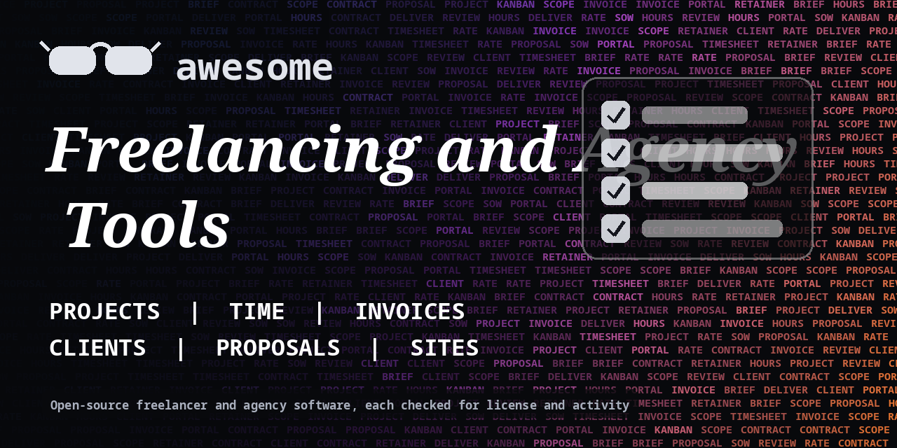

<h1 align="center">Awesome Freelancing and Agency Tools</h1>

> Open-source tools for freelancers and small agencies: projects, time tracking, invoicing, proposals, client portals and websites. Every entry shows its license.

**Rules of this list:** every repo exists, is public, is not archived, states a license and has had a commit in the last year. One plain sentence each. Star counts and claims are the authors' own, we did not test every tool. Checked 2026-10-18. See [CONTRIBUTING.md](CONTRIBUTING.md).

## Contents

- [Project and task management](#project-and-task-management)
- [Time tracking](#time-tracking)
- [Invoices and payments](#invoices-and-payments)
- [Proposals, contracts and signing](#proposals-contracts-and-signing)
- [Clients and CRM](#clients-and-crm)
- [Client portals and support](#client-portals-and-support)
- [Websites and portfolios](#websites-and-portfolios)
- [Booking and calls](#booking-and-calls)
- [How to choose](#how-to-choose)
- [Contributing](#contributing)

## Project and task management

Boards, tasks and client projects.

- [AppFlowy-IO/AppFlowy](https://github.com/AppFlowy-IO/AppFlowy)  - Open-source Notion alternative. _(AGPL-3.0)_
- [kanboard/kanboard](https://github.com/kanboard/kanboard)  - Simple kanban project management software. _(MIT)_
- [makeplane/plane](https://github.com/makeplane/plane)  - Open-source project management tool for tasks, cycles and docs. _(AGPL-3.0)_
- [redmine/redmine](https://github.com/redmine/redmine)  - Flexible project management web application. _(check repo)_
- [taigaio/taiga-back](https://github.com/taigaio/taiga-back)  - Backend of the Taiga agile project management tool. _(MPL-2.0)_
- [wekan/wekan](https://github.com/wekan/wekan)  - Open-source kanban board. _(MIT)_

## Time tracking

Track hours per client.

- [ActivityWatch/activitywatch](https://github.com/ActivityWatch/activitywatch)  - Open-source automated time tracker. _(MPL-2.0)_
- [kimai/kimai](https://github.com/kimai/kimai)  - Open-source time tracking application. _(AGPL-3.0)_
- [solidtime-io/solidtime](https://github.com/solidtime-io/solidtime)  - Open-source time tracker for freelancers and teams. _(AGPL-3.0)_
- [wakatime/wakatime-cli](https://github.com/wakatime/wakatime-cli)  - Command-line tool for the WakaTime coding time tracker. The service has paid plans. _(BSD-3-Clause)_

## Invoices and payments

Bill clients.

- [akaunting/akaunting](https://github.com/akaunting/akaunting)  - Free online accounting software. _(check repo)_
- [btcpayserver/btcpayserver](https://github.com/btcpayserver/btcpayserver)  - Self-hosted Bitcoin payment processor. _(MIT)_
- [invoiceninja/invoiceninja](https://github.com/invoiceninja/invoiceninja)  - Invoicing, quotes and payments for small businesses. _(check repo)_
- [InvoiceShelf/InvoiceShelf](https://github.com/InvoiceShelf/InvoiceShelf)  - Open-source invoicing app for freelancers and small businesses. _(AGPL-3.0)_

## Proposals, contracts and signing

Send documents and collect signatures.

- [documenso/documenso](https://github.com/documenso/documenso)  - Open-source document signing platform. _(AGPL-3.0)_
- [docusealco/docuseal](https://github.com/docusealco/docuseal)  - Open-source document filling and signing. _(AGPL-3.0)_
- [OpenSignLabs/OpenSign](https://github.com/OpenSignLabs/OpenSign)  - Open-source document signing platform. _(check repo)_

## Clients and CRM

Keep contacts and notes.

- [espocrm/espocrm](https://github.com/espocrm/espocrm)  - Open-source CRM platform you can self-host. _(AGPL-3.0)_
- [frappe/crm](https://github.com/frappe/crm)  - Open-source CRM built on the Frappe framework. _(AGPL-3.0)_
- [monicahq/monica](https://github.com/monicahq/monica)  - Personal CRM to remember details about people you know. _(AGPL-3.0)_
- [twentyhq/twenty](https://github.com/twentyhq/twenty)  - Modern open-source CRM. _(check repo)_

## Client portals and support

Share files and status with clients.

- [chatwoot/chatwoot](https://github.com/chatwoot/chatwoot)  - Open-source customer messaging and shared inbox. _(check repo)_
- [cryptpad/cryptpad](https://github.com/cryptpad/cryptpad)  - End-to-end encrypted collaboration suite. _(AGPL-3.0)_
- [nextcloud/server](https://github.com/nextcloud/server)  - Self-hosted cloud for files, calendar, contacts and docs. _(AGPL-3.0)_
- [zammad/zammad](https://github.com/zammad/zammad)  - Web-based open-source helpdesk and support system. _(AGPL-3.0)_

## Websites and portfolios

Portfolio and landing page templates.

- [11ty/buildawesome](https://github.com/11ty/buildawesome)  - Simple static site generator in JavaScript. _(MIT)_
- [gohugoio/hugo](https://github.com/gohugoio/hugo)  - Fast static site generator written in Go. _(Apache-2.0)_
- [vercel/next.js](https://github.com/vercel/next.js)  - React framework for the web. _(MIT)_
- [withastro/astro](https://github.com/withastro/astro)  - Web framework for content-driven sites. _(check repo)_

## Booking and calls

Let clients book time.

- [alextselegidis/easyappointments](https://github.com/alextselegidis/easyappointments)  - Self-hosted appointment scheduler. _(GPL-3.0)_
- [calcom/cal.diy](https://github.com/calcom/cal.diy)  - Open-source scheduling infrastructure, an alternative to Calendly. _(MIT)_

## How to choose

- **Put it in writing.** Scope, price and dates go in a contract.
- **Own your data.** Pick tools that export clients and invoices.
- **Check the license.**
- **Start small.** One tool for time and invoices is enough.

## Contributing

See [CONTRIBUTING.md](CONTRIBUTING.md). One entry per pull request, plain words, real sources only.

## About

Maintained by [@devanasolver](https://github.com/devanasolver). Listings follow the rules in CONTRIBUTING.

## Sponsor me

If this list is useful, [buy me a coffee](https://buymeacoffee.com/isaac49).
